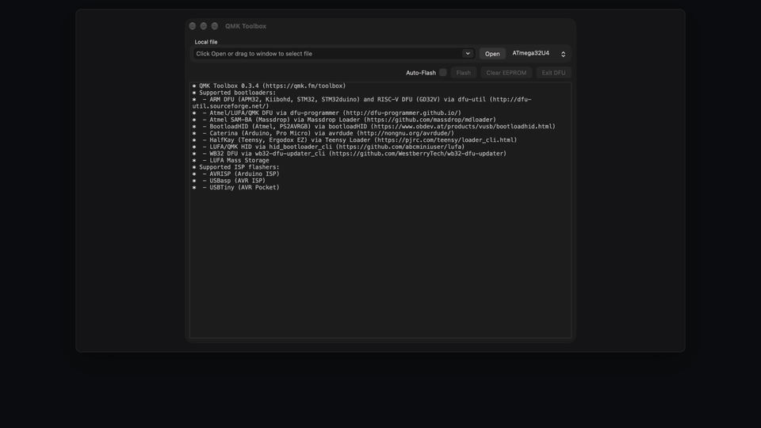
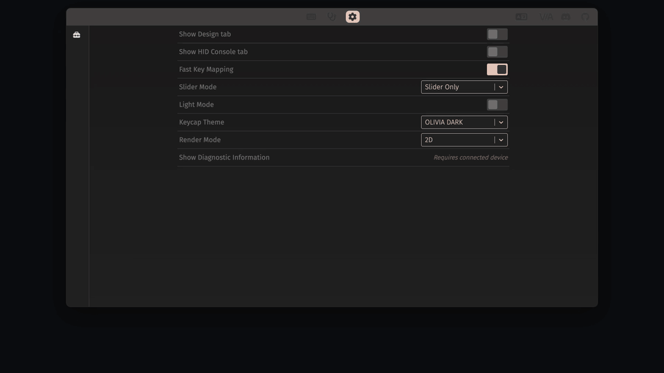

# Merisi QMK firmware

This repository contains the firmware for Merisi keyboards. The firmware uses [QMK](https://qmk.fm).
You can use the firmware with [VIA](https://usevia.app) or [Vial](https://get.vial.today).
You can also change the firmware to make your keymap in QMK.

| Keyboard | Folder | Hardware test |
| --- | --- | --- |
| Merisi Sessanta | [`keyboards/merisi/sessanta`](keyboards/merisi/sessanta) | Completed |

## Download

The firmware files are on the [Releases page](../../releases/latest). Select one of these alternatives:

| File | Use |
| --- | --- |
| `merisi_sessanta_via.bin` and `merisi_sessanta_via.json` | **VIA (recommended).** Change the keymap in the VIA web app. |
| `merisi_sessanta_vial.bin` | **Vial.** Change the keymap in the Vial app. It is not necessary to load a different file. |
| `merisi_sessanta_default.bin` | QMK without VIA or Vial. To change the keymap, you must compile the firmware again. |

When you flash a file, the keyboard erases its keymap. The keyboard then uses the default layout.

Two animations show the procedure for the VIA file:

1. [Flash the firmware](#flash-the-merisi-sessanta) with QMK Toolbox.
2. [Add the Sessanta to VIA](#use-via).

## Flash the Merisi Sessanta

The animation shows the procedure in QMK Toolbox on macOS.

Full-size video: [flash-firmware.mp4](docs/media/flash-firmware.mp4)

1. Put the keyboard in bootloader mode. Push the **RESET** button on the PCB, or hold **Esc** when you connect the cable.
   The keyboard stops the input of characters. The computer then shows a device with the name "STM32 BOOTLOADER".

   > **Warning:** When you hold Esc and connect the cable, the keyboard erases its keymap and settings.
   > This also occurs when you do not flash a file. Before you use Esc, save your layout.
   > In VIA, use the "Save + Load" tab. In Vial, select File, then "Save current layout".
   > The RESET button does not erase the keymap or the settings.

2. Flash the `.bin` file with one of these tools:
   * [QMK Toolbox](https://github.com/qmk/qmk_toolbox/releases) (macOS and Windows). Open the `.bin` file. Then click **Flash**.
   * `dfu-util` (all operating systems):

         dfu-util -a 0 -d 0483:df11 -s 0x08000000:leave -D merisi_sessanta_via.bin

3. The keyboard starts again automatically. If it does not start, disconnect the cable. Then connect it again.

The bootloader is in the microcontroller. Thus, you can always use the RESET button, also after an incorrect flash.
If the keyboard does not operate after a flash, push RESET. Then flash the file again.

## Use VIA

The Sessanta is not in the VIA list of keyboards. Load the definition file one time:

Full-size video: [via-setup.mp4](docs/media/via-setup.mp4)

1. Open [usevia.app](https://usevia.app) in Chrome or Edge.
2. In **Settings**, set "Show Design tab" to on.
3. In **Design**, click **Confirm**. Then load `merisi_sessanta_via.json`.
4. In **Configure**, click **Authorize device**. Select **Sessanta**, then click **Connect**.
   VIA shows "MERISI SESSANTA" at the top right. You can then change the keymap.

The **Layouts** tab has the alternatives for split Backspace and split right Shift.

The "Test Matrix" function in VIA does not show keys. QMK does not send the switch states to VIA.
If QMK sends the switch states, other programs can read the keys that you push.
To do a test of the keys, use the key tester in VIA or the matrix tester in Vial.

## Use Vial

Open [Vial](https://get.vial.today) (desktop app or web). The layout is in the firmware. Thus, it is not necessary to load a file.
Some functions are locked, for example the matrix tester. To unlock them, hold **Esc** and **Enter** when Vial tells you.

## Merisi Sessanta

* 60% PCB with an STM32F072RBT6 microcontroller and a RESET button.
* A 4-pin JST cable connects the PCB to a USB-C daughterboard.
* Layout alternatives: split Backspace and split right Shift. The 1u key at the right of the split right Shift is Fn.
* Bottom row: 1.5u, 1u, 1.5u, 7u, 1.5u, 1u, 1.5u.
* QMK layout names: `LAYOUT_60_ansi_tsangan_split_bs_rshift` and `LAYOUT_60_ansi_tsangan`.
* USB ID `4D57:5336`. The computer shows the keyboard as "Sessanta" by "Merisi".
* The default keymap is standard ANSI. Fn (`MO(1)`) selects layer 1. Layers 1 to 3 are empty. You can add your keys to these layers.

## Compile from source code

To compile QMK or VIA firmware, use [QMK](https://github.com/qmk/qmk_firmware). We did tests with version 0.34.8.

    cp -R keyboards/merisi/sessanta <qmk_firmware>/keyboards/merisi/
    qmk compile -kb merisi/sessanta -km default     # or -km via, or your own keymap

To compile Vial firmware, use [Vial-QMK](https://github.com/vial-kb/vial-qmk). We did tests with commit `dd43959`.

    cp -R keyboards/merisi/sessanta <vial-qmk>/keyboards/merisi/
    make merisi/sessanta:vial

The Vial release also uses [`patches/vial-nkro-default.patch`](patches/vial-nkro-default.patch) on Vial-QMK.
With this patch, the "Reset settings" command in Vial keeps N-key rollover on. N-key rollover on is the default for this keyboard.
Without the patch, the firmware operates the same, but the "Reset settings" command sets N-key rollover to off.

We compiled the releases with `arm-none-eabi-gcc` 8.5.0.

## License

This firmware has the GPL-2.0-or-later license, the same as QMK. Refer to [LICENSE](LICENSE).
You can use, change, and give this firmware to other persons. If you give a changed version to other persons, you must also give its source code.
